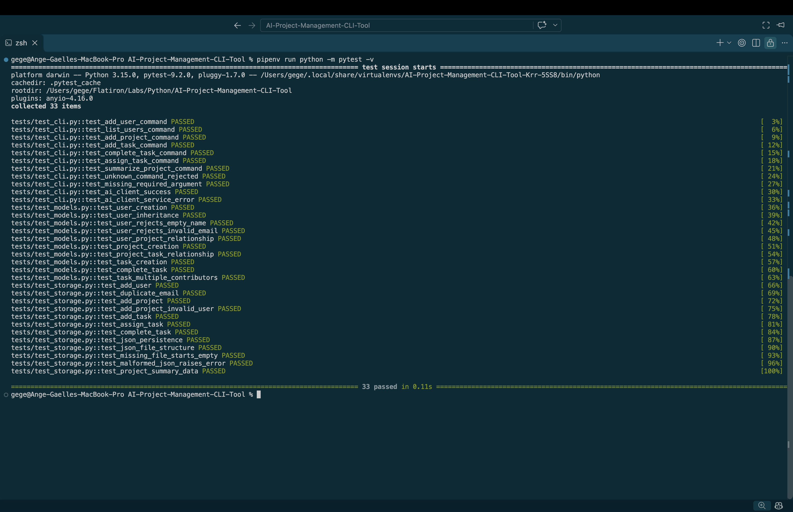

# Python Project Management CLI Tool

## Project Overview

The Python Project Management CLI Tool is a command-line application that helps administrators organize users, projects, and tasks.

The application is built using object-oriented programming (OOP) principles and supports persistent data storage using JSON files.

It also integrates with Ollama, a local AI service, to generate project summaries, identify risks, and recommend next steps.

## Features

- Create and manage users.
- Create projects and associate them with users.
- Add tasks to projects.
- Assign multiple contributors to tasks.
- Mark tasks as complete.
- List users, projects, and tasks.
- Filter projects by user.
- Filter tasks by project.
- Save application data to JSON.
- Automatically load saved data.
- Generate AI-powered project summaries.
- Handle invalid input and service errors.
- Run automated tests using Pytest.

## Technologies Used

- Python 3.10+
- Object-Oriented Programming
- argparse
- JSON
- Ollama
- Llama 3.2
- Pytest
- Git and GitHub

## Installation

### 1. Clone the Repository

```bash
git clone git@github.com:a-gbatie/AI-Project-Management-CLI-Tool.git
cd AI-Project-Management-Cli-Tool
```

### 2. Install Dependencies

Make sure Python 3.10 or newer is installed.

Install the required Python packages:

```bash
python3 -m pip install -r requirements.txt
```

Alternatively, using Pipenv:

```bash
pipenv install -r requirements.txt
```

### 3. Install Ollama

Install Ollama from:

https://ollama.com

Download the Llama 3.2 model:

```bash
ollama pull llama3.2:3b
```

Check that the model is available:

```bash
ollama list
```

### 4. Start the Ollama Service

```bash
ollama serve
```

Keep this terminal running when generating AI project summaries.

## Running the CLI

From the project root directory:

```bash
python main.py --help
```

If using Pipenv:

```bash
pipenv run python main.py --help
```

The application uses command-line subcommands to manage users, projects, and tasks.

## Available Commands

| Command | Description |
|---------|-------------|
| `add-user` | Create a new user |
| `list-users` | Display all users |
| `add-project` | Create a project |
| `list-projects` | Display projects |
| `add-task` | Create a task |
| `list-tasks` | Display tasks |
| `assign-task` | Assign a contributor to a task |
| `complete-task` | Mark a task complete |
| `summarize-project` | Generate an AI project summary |

## Example Usage

### Create a User

```bash
python main.py add-user --name "Alex" --email "alex@example.com"
```

Example output:

```text
User created: [1] Alex (alex@example.com) - 0 project(s)
```

### List Users

```bash
python main.py list-users
```

### Create a Project

```bash
python main.py add-project --user "Alex" --title "CLI Tool" --description "Build a Python project tracker"
```

You can optionally provide a due date:

```bash
python main.py add-project --user "Alex" --title "Website" --due-date "2026-12-01"
```

### List Projects

```bash
python main.py list-projects
```

Filter by user:

```bash
python main.py list-projects --user "Alex"
```

### Create a Task

```bash
python main.py add-task --project "CLI Tool" --title "Implement add-task command"
```

### List Tasks

```bash
python main.py list-tasks
```

Filter by project:

```bash
python main.py list-tasks --project "CLI Tool"
```

### Assign a Task

```bash
python main.py assign-task --project "CLI Tool" --task "Implement add-task command" --user "Alex"
```

A task can have multiple contributors.

### Complete a Task

```bash
python main.py complete-task --project "CLI Tool" --task "Implement add-task command"
```

### Generate an AI Project Summary

```bash
python main.py summarize-project --project "CLI Tool"
```

The AI analyzes the project information and produces:

1. Project Summary
2. Current Progress
3. Risk Notes

## Object-Oriented Programming Design

The application uses three primary data models:

### Person

The `Person` class is a base class containing shared information such as name and email.

### User

The `User` class inherits from `Person`.

Each user has:

- A unique ID.
- A name.
- An email address.
- A collection of owned project IDs.
- A collection of assigned task IDs.

The `project_count` property returns the number of projects associated with a user.

### Project

Each project has:

- A unique ID.
- A title.
- A description.
- A due date.
- An owner.
- A collection of task IDs.

The `task_count` property returns the number of tasks associated with a project.

### Task

Each task has:

- A unique ID.
- A title.
- A project association.
- A completion status.
- A collection of assigned contributors.

The `is_complete` property indicates whether a task has been completed.

### OOP Concepts Demonstrated

**Encapsulation:** Model methods manage task completion and relationships.

**Inheritance:** The `User` class inherits shared attributes from `Person`.

**Properties:** `@property` is used for calculated attributes.

**Composition and relationships:** Users own projects, and projects contain tasks.

**Modularity:** Models, storage, CLI, and AI services are separated into different modules.

## Data Persistence

The application stores data in:

```text
data/project_data.json
```

The JSON file contains three collections:

```json
{
    "users": [],
    "projects": [],
    "tasks": []
}
```

### AI Summary Features

The AI can generate:

- Project progress summaries.
- Risk notes.
- Suggested next steps.

The prompt instructs the model to avoid inventing unsupported details.

## Testing

The application uses Pytest.

Run all tests:

```bash
python -m pytest -v
```

Or, with Pipenv:

```bash
pipenv run pytest -v
```

Stop after the first failure:

```bash
python -m pytest -x
```

### Test Categories

**Model Tests**

- User creation and validation.
- Inheritance.
- Project relationships.
- Task completion.
- Multiple contributors.

**Storage Tests**

- Creating users, projects, and tasks.
- Relationship management.
- JSON saving and loading.
- Missing files.
- Malformed JSON.
- Structured project summary data.

**CLI Tests**

- Command parsing.
- Creating users.
- Creating projects.
- Creating tasks.
- Completing tasks.
- Assigning contributors.
- AI summary integration.
- Invalid commands and missing arguments.

**AI Client Tests**

- Successful response extraction.
- Service error handling.

The automated tests use fake AI responses so the Ollama server does not need to run during testing.

## Error Handling

The application handles several common errors.

### Invalid User Information

Users must have a nonempty name and a valid-looking email address.

### Missing Users or Projects

Commands return descriptive errors when referenced users, projects, or tasks cannot be found.

### Duplicate Emails

The application rejects duplicate user email addresses.

### Invalid Commands

The CLI uses `argparse` to validate command names and required arguments.

### File Errors

Missing data files are handled by initializing empty collections.

Malformed JSON produces a clear error.

### AI Service Errors

If Ollama is unavailable or returns an invalid response, the AI client raises a readable runtime error.


## Screenshot of Completed Tests


